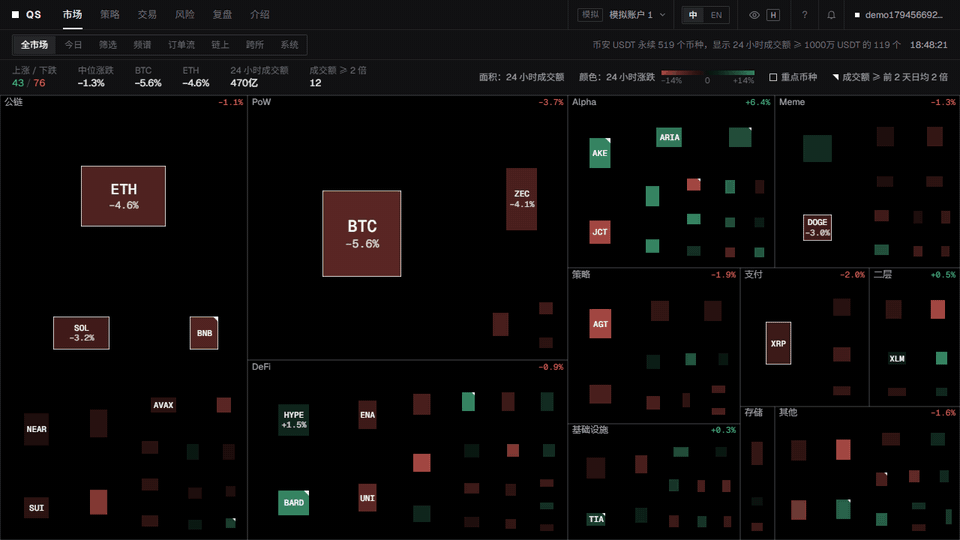

# Temper

English | [简体中文](README.zh-CN.md) | [繁體中文](README.zh-TW.md)

A self-hosted workstation for crypto perpetual futures: live market data, a realistic paper-trading engine, backtesting, trade review, and optional order routing to your own Binance account. Built for individuals and small teams who want to test their own strategies.


> The authors only provide this software. They do not run any fund, signal, copy-trading, paid or referral service, and do not recommend any trade.
> Whether and how you use it, and whether that is legal where you live, is your own decision and responsibility. Futures trading can lose your entire margin.

## What it does

| | |
| --- | --- |
| Market data | Binance USDⓈ-M perpetuals: live order book, trades and candles; Hyperliquid on-chain large positions and liquidation map; cross-venue funding and spreads |
| Paper trading | Matches Binance rules item by item: fees, margin tiers, liquidation and clearing fee, price and size filters, market-order protection, conditional (algo) orders, funding settled at real rates; optional simulated order latency by region |
| Backtesting | Runs Binance historical 1-minute candles (last and mark price) and historical funding through **the same matching engine** as paper trading |
| Strategies | TradingView alerts / webhooks (a sentence or JSON); the qsig/1 target-position protocol for programs (self-service keys, forward record, validation report); a Binance-compatible API (point an existing Binance bot at it and it trades on paper) |
| Live trading | Connect your own Binance USDⓈ-M futures account: keys need trading only (never withdrawals) and are stored encrypted; order confirmation is on by default (can be turned off per account with a trade password) |
| Review | Trade journal, performance, MAE/MFE, conclusions, playbooks, replay practice, highlights |
| Risk | Discipline locks (daily loss, losing streak, giving back profit, max drawdown, risk per trade) for both paper and live accounts; off by default, turn it on on the Risk page |
| System | Global halt (stop new positions / also cancel opening orders, enforced on every order path); outgoing mail, AI review, Telegram and data source keys set on the web; sign-up switch (closed after the first account by default); append-only audit log. No admins or roles: every account on an install has the same rights |



## Quick start

All you need is Docker (Docker Desktop on Windows and macOS) and Git. Get the code and run one command in its folder:

```bash
git clone https://github.com/yk-hello/temper.git
cd temper
docker compose up -d
```

No Git? On the GitHub page click Code → Download ZIP, unzip it, and run the last line in that folder.

The first run builds locally and takes a few minutes. Then open http://localhost:8080 and register an account:

- **No keys or config files needed.** Market data comes from Binance's public feed; sign-up needs only an account name and a password and you are signed in right away (you can link an email later on the Account page to recover your password and get alerts); every account comes with a 10,000 USDT paper account; paper balances have no limit and can be topped up, reduced or reset at any time, and fees can be set to match your tier.
- The first account registered owns the install: only it can open the System page behind the gear at the top right (all accounts, global settings, activity log). After it signs up, nobody else can sign up by default (safe on a cloud server too); to add accounts, use the System page or open sign-up there. Other accounts only see their own data.
- If Binance is unreachable where you are (the top bar keeps saying "connecting"), create a `.env` file containing `MARKET_SOURCE=sim` and run the command again to explore with simulated prices.
- Stop: `docker compose down` (data is kept). To upgrade to a new release or go back to the previous one, see "Upgrading and rolling back" in the [FAQ](docs/faq.en.md) (data and settings are kept).

**On a cloud server**: by default the web page only opens on the server itself (nothing is exposed, which is the safest setup). Open an SSH tunnel from your own computer:

```bash
ssh -L 8080:127.0.0.1:8080 your-user@server-ip
```

Keep that window open and browse to http://localhost:8080 on your computer. To open it by domain name without a tunnel (on a phone, for example), read "Security" below first: set up HTTPS and a domain, then change `QS_BIND`, `ALLOWED_ORIGINS` and `SITE_DOMAIN`.

To change the port, send mail from your own mailbox, use Telegram, or connect Binance, see "Configuration" below. Outgoing mail, AI review, Telegram and data source keys can also be set without editing files: sign in and fill them in under System settings on the System page (the gear at the top right); they take effect on save, and each group has a Test button. See also the [FAQ](docs/faq.en.md).

The interface is available in Chinese and English (switch under Account → Language).

## Configuration (`.env`, never commit it)

Everything is optional. Copy [.env.example](.env.example) to `.env`, change the lines you need, and run `docker compose up -d` again.

| You want to | Configure |
| --- | --- |
| Watch the market, paper trade, backtest, review, connect strategies to paper accounts | Nothing |
| Password recovery, email notifications | Recommended: outgoing mail (`SMTP_*`) |
| Telegram notifications | Optional: `TELEGRAM_BOT_TOKEN` ([how](docs/telegram.md), in Chinese) |
| Trade on your own Binance account | No environment variable: add a futures-trading-only key under Account in the web app ([details](docs/live.md), in Chinese) |
| Open it from other devices on your LAN | `QS_BIND=0.0.0.0` and `ALLOWED_ORIGINS` (read "Security" first) |
| AI review comments | Optional. The easiest way is the provider list on the System page: add as many providers as you like (name, API format, base URL, key, model, thinking level), switch with one click, and test each one. Two API formats: Anthropic (Claude) and OpenAI-compatible (DeepSeek, Qwen, Kimi, GLM, OpenAI, Google Gemini and most relays). Or put it in `.env`: `AI_API_KEY`, `AI_BASE_URL`, `AI_MODEL`; for Claude set `AI_FORMAT=anthropic` and only `AI_API_KEY` is needed (defaults to `claude-opus-5-5`); thinking level `AI_EFFORT` (`none`, `low`, `medium`, `high`, `xhigh`; empty uses the model's own setting). A provider selected on the System page takes precedence |
| News headlines | Nothing (public RSS from a few crypto outlets plus official Bybit and OKX notices by default); change sources with `NEWS_FEEDS`; follow X accounts with `X_BEARER_TOKEN` + `X_ACCOUNTS` |
| Keep the economic calendar updating by itself; see the dollar index and Treasuries | Recommended: `FRED_API_KEY` (free, see below) |

Main variables:

| Variable | Purpose |
| --- | --- |
| `QS_MASTER_KEY` | Master key that encrypts exchange and strategy keys. If unset, one is generated on first start and stored in the `qs-data` volume (**back it up**: `docker compose cp backend:/data/master.key .`). To set your own: `openssl rand -base64 32`. If it is lost, stored keys cannot be decrypted and must be added again |
| `MARKET_SOURCE` | `binance` (default, Binance public data, no key) or `sim` (simulated prices) |
| `BINANCE_SPOT_WS_URL` | Optional: where spot market data streams from. Defaults to `wss://stream.binance.com:443`; if your network blocks it, try `wss://data-stream.binance.vision:443`. Futures data is not affected |
| `QS_PORT` / `QS_BIND` | Web port (default 8080) and listen address (default `127.0.0.1`, this machine only) |
| `ALLOWED_ORIGINS` | Which addresses may open the app (localhost only by default). Add your LAN IP or domain, e.g. `192.168.1.10:*` |
| `QSIG_KEYS` | Keys for programmatic strategies: `key_id:secret:strategy_id`, separated by semicolons |
| `BINANCE_API_KEY` / `BINANCE_API_SECRET` | Optional, read-only is enough: loads real margin tiers for every symbol (without it only BTC has the full table) |
| `QS_LIVE_MAIN` / `QS_LIVE_TESTNET` | Set to `0` to disallow Binance production / Binance demo trading |
| `SMTP_HOST` / `SMTP_PORT` / `SMTP_USER` / `SMTP_PASSWORD` | Optional, send mail from your own mailbox: codes for linking an email, password recovery, alert emails. For Gmail: `smtp.gmail.com` / `465` with an app password (not your login password); QQ Mail and 163 work the same way. Microsoft mailboxes (Outlook, Hotmail, Microsoft 365) do not work: they only accept OAuth2 sign-in. Port 465 uses TLS, 587 uses STARTTLS; mail is never sent over an unencrypted connection |
| `MAIL_FROM` / `MAIL_FROM_NAME` | Optional: sender address (defaults to `SMTP_USER`) and display name. Once mail is configured, each user's notification settings gain an "Email" column (on by default only for money and security events such as liquidation warnings and new-device sign-ins; at most 20 emails per user per hour) |
| `AUTH_DEV` | Leave it unset. Without outgoing mail, linking an email needs no code and a forgotten password is reset with a local command (not in the browser, so nobody can reset your password with your email); with mail, codes are emailed. `1` is for developers only: codes are shown on the page; never use it on a machine others can reach |
| `QS_WEBHOOK_PRIVATE` | Default `0`: outgoing webhooks are never sent to localhost or private networks. Set `1` only on a private network where you need that |
| `NEWS_FEEDS` | Where the headlines on the market "Today" tab come from: public RSS from CoinDesk, Cointelegraph and Decrypt by default; your own comma-separated list; `off` to disable. Only titles, source, time and link are stored and shown, never article text; the app never turns news into trading calls |
| `X_BEARER_TOKEN` / `X_ACCOUNTS` | Optional: your own X developer token (official API, paid per use) to follow a few accounts, polled every 15 minutes. No scraping |
| `FRED_API_KEY` | Recommended: a free key from the St. Louis Fed ([fred.stlouisfed.org](https://fred.stlouisfed.org), My Account → API Keys). With it, CPI, payrolls, PPI and FOMC dates update automatically, and the market "Today" tab adds the dollar index, the US 10-year yield and the S&P 500. Without it, BEA dates (PCE, GDP) still update online; BLS (CPI, payrolls, PPI) refuses programmatic access, so the built-in schedule is used (currently through the end of 2027) and the page warns two months before it runs out; new versions ship an updated schedule |
| `QS_LIMIT_*` | Optional per-person limits; defaults apply when unset. `QS_LIMIT_PAPER_ACCOUNTS` (paper accounts, 10), `QS_LIMIT_BACKTEST_DAYS` / `_INSTRUMENTS` / `_SIGNALS` (per backtest run: 180, 5, 20000), `QS_LIMIT_STRATEGIES` (20), `QS_LIMIT_API_KEYS` (Binance-compatible API keys, 10), `QS_LIMIT_PRICE_ALERTS` (50), `QS_LIMIT_RULES` (condition alerts, 20), `QS_LIMIT_SHOT_MB` / `QS_LIMIT_SHOTS_TOTAL_MB` (review screenshots, each and total: 5, 500), `QS_LIMIT_SIGNUP_PER_IP_HOUR` (sign-ups per network per hour, 10). Messages in the app follow the values you set. Paper balances themselves have no limit |
| `NEWS_NOTICES` / `LIQ_FEEDS` | Both on by default: `off` disables official Bybit and OKX notices (listings, delistings, maintenance) or their full liquidation streams (Binance pushes at most one liquidation per coin per second, so it undercounts) |
| `QS_SIGNUP` | Optional: `open` lets others sign up after the first account. Defaults to `closed`: anyone who signs up can change every setting on the System page just like you, so only open it on your own computer or for people you trust (also switchable on the System page) |

## Documentation

The detailed guides are in Chinese for now, except the protocol:

- [Strategy author guide](docs/strategy-guide.md): what fits, how to validate, common pitfalls, empty template (we do not provide strategies)
- [Connecting strategies](docs/strategies.md): TradingView / webhooks, qsig/1, from backtest to paper to live
- [Market data for strategies](market-data.md): where to get candles, funding, open interest, news and macro data, how much history each has, and when each value is actually known
- [Keeping a strategy running](running.md): Docker, systemd or a Windows loop script so it comes back after a crash or reboot; why a restart does not double orders
- [Backtesting](docs/backtest.md): signal tables, command line, how it differs from real trading
- [Binance live trading](docs/live.md): creating keys, security design, paper-only features
- [Binance-compatible API](docs/binance-api.md): run an existing Binance program on paper by changing the base URL and key
- [Telegram notifications](docs/telegram.md): the operator creates a bot (optional); each user links their own chat
- [qsig/1 protocol](docs/qsig-1.en.md) (English): target-position format, signing, acknowledgements
- Example code: [examples/](docs/examples/) (Python standard library only)

## Security

- Exchange keys need "futures trading" only; keys with withdrawal or transfer permission are refused. The code contains no withdrawal or transfer calls.
- Listens on this machine only by default (`127.0.0.1:8080`). Before exposing it, set up HTTPS, outgoing mail (`SMTP_*`; otherwise a forgotten password can only be reset with a command on the server), `SITE_DOMAIN`, and change the database password.
- Do not open it over plain `http://` from the internet: anyone on the same network can read the sign-in password, codes and session cookie. Use an SSH tunnel or HTTPS; the sign-in page warns "Connection not encrypted" when opened over an unencrypted address.
- When mail goes out from your own mailbox, recipients see your sender address; personal mailboxes such as Gmail can send a few hundred messages a day, so use a dedicated mail service for larger groups.
- Please report security issues privately to the maintainers rather than in a public issue.

## License

[Apache License 2.0](LICENSE): free to use, modify and redistribute, including commercially; keep the copyright notice and [NOTICE](NOTICE), and mark files you changed. Provided "as is" without warranty; no trademark rights are granted.

Third-party components and their licenses are listed in [THIRD_PARTY.md](THIRD_PARTY.md) (all permissive: MIT, Apache-2.0, ISC, BSD, and OFL for fonts).

This project provides no trading strategies, signals or investment advice. Your accounts, keys and money are your own, and so are the results.
