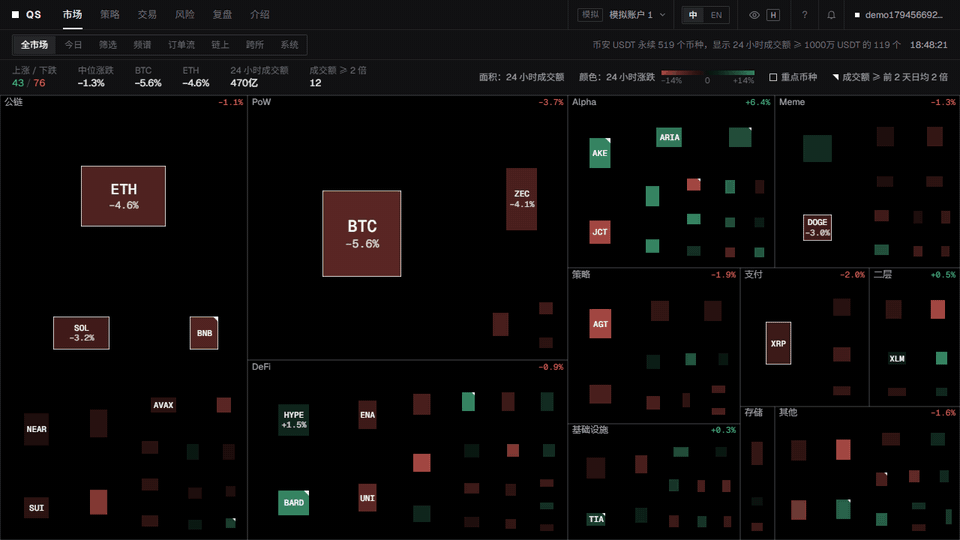

# Temper

[English](README.md) | 简体中文 | [繁體中文](README.zh-TW.md)

自己部署的加密货币合约交易工作台：真实行情、仿真模拟盘、回测、复盘，也可以接自己的币安账户下单。给个人测试自己的策略用：一台装的东西是你一个人的，装在自己电脑、服务器还是云上都一样。


> 作者只提供这份软件，不运营任何资金、带单、跟单、收费或返佣服务，也不推荐任何交易。
> 用不用、怎么用、是否符合你所在地区的法律，由你自己判断和负责。合约交易可能亏掉全部保证金。

## 能做什么

| | |
| --- | --- |
| 行情 | 币安 U 本位永续的实时盘口、成交、K 线；Hyperliquid 链上大额持仓和强平地图；跨所资金费和价差 |
| 模拟盘 | 逐条对齐币安的规则：手续费、保证金分档、强平和清算费、价格和数量限制、市价单保护、条件单（Algo）、资金费按真实结算；可以模拟不同地区的下单延迟 |
| 回测 | 用模拟盘**同一个撮合引擎**跑币安历史 1 分钟 K 线（最新价和标记价）和历史资金费 |
| 接策略 | TradingView 警报 / Webhook（一句话或 JSON）；程序化的 qsig/1 目标仓位协议（自助建密钥、前向记录、验证报告）；和币安一样的接口（现成的币安程序改个地址就跑在模拟盘上） |
| 实盘 | 接自己的币安 U 本位合约账户：密钥只开交易、不开提现，加密保存；下单确认默认打开（按账户关，要二级密码） |
| 复盘 | 交易日志、绩效、MAE/MFE、结论、预案、回放练习、高光 |
| 风控 | 纪律锁（单日亏损、连续亏损、利润回吐、最大回撤、每笔风险），对模拟盘和实盘都生效；默认关着，在风险页打开 |
| 系统 | 全局停机（停止开新仓 / 再撤掉开仓挂单，所有下单路径都拦）；发信邮箱、AI 复盘点评、Telegram、数据源密钥在网页里填；注册开关（第一个账号以后默认关）；操作记录只追加。没有管理员和角色：这台的账号权限都一样 |



## 快速开始

只需要装好 Docker（Windows、macOS 用 Docker Desktop）和 Git。下载代码，在文件夹里运行一条命令：

```bash
git clone https://github.com/yk-hello/temper.git
cd temper
docker compose up -d
```

不想装 Git：在 GitHub 页面上点 Code → Download ZIP，解压后进到文件夹里运行最后一行。

第一次要在本机构建，等几分钟。然后浏览器打开 http://localhost:8080 ，注册一个账号就能用：

- **不需要任何密钥和配置文件。** 行情用币安的公开数据；注册只要账户名和密码，注册完直接进去（邮箱可以以后在账户页绑定，用来找回密码、收提醒）；每个账号自带一个 10,000 USDT 的模拟账户；模拟资金不限额度，可以随时加减、重置，手续费也能按自己的等级改。
- 第一个注册的账号是这台的所有者：只有它能进右上角齿轮的"系统"页（全部账号、全局设置、操作记录）。第一个账号注册后，别人默认就注册不进来了（放在云上也安全）；要多开账号，在"系统"页里添加，或者打开注册。别的账号只看得到自己的东西。
- 连不上币安的地方（页面顶上一直显示"连接中"）：建一个 `.env` 文件，写一行 `MARKET_SOURCE=sim`，再运行一次上面的命令，用模拟行情看界面。
- 停掉：`docker compose down`（数据留着）。升级到新版本、退回上一个版本：见[常见问题](docs/faq.md)的"升级和退回"（数据和设置都留着）。

**装在云服务器上**：网页默认只在服务器本机能打开（不对外，最安全）。在你自己的电脑上开一条 SSH 隧道就能用：

```bash
ssh -L 8080:127.0.0.1:8080 你的用户名@服务器IP
```

连着这个窗口，在自己电脑的浏览器打开 http://localhost:8080 。想不开隧道、直接用域名打开（比如手机上用），先看下面的"安全"：要配 HTTPS 和域名，再改 `QS_BIND`、`ALLOWED_ORIGINS`、`SITE_DOMAIN`。

要改端口、接自己的邮箱发信、接 Telegram、接币安实盘，看下面的"配置"。发信邮箱、AI 复盘点评、Telegram、数据源密钥也可以不写文件：登录后在"系统"页（右上角的齿轮）的"系统设置"里填，保存后马上生效，每项有"测试"按钮。常见问题见 [faq.md](docs/faq.md)。

## 配置（`.env`，不要提交到仓库）

全部可选。抄一份 [.env.example](.env.example) 成 `.env`，改你要的那几行，再运行一次 `docker compose up -d`。

| 你想做什么 | 要不要配 |
| --- | --- |
| 看行情、用模拟盘、回测、复盘、接策略到模拟盘 | 不用配 |
| 忘记密码能找回、邮件通知 | 推荐配发信邮箱（`SMTP_*`） |
| Telegram 通知 | 可选：`TELEGRAM_BOT_TOKEN`（[怎么建](docs/telegram.md)） |
| 接自己的币安账户下单 | 不用配环境变量：在网页"账户"里填只开了合约交易的密钥（[说明](docs/live.md)） |
| 让局域网里别的设备也能打开 | `QS_BIND=0.0.0.0` 和 `ALLOWED_ORIGINS`（先看"安全"） |
| AI 复盘点评 | 可选。推荐登录后在"系统"页加厂商：可以加好几家（名字、接口格式、地址、密钥、模型、思考程度），用哪家点一下就换，每家能单独测试。接口格式两种：Anthropic（Claude）和 OpenAI 兼容（DeepSeek、通义千问、Kimi、智谱、OpenAI、Google Gemini 和大多数中转站）。也可以写在 `.env`：`AI_API_KEY`、`AI_BASE_URL`、`AI_MODEL`；用 Claude 写 `AI_FORMAT=anthropic`，只填 `AI_API_KEY` 就行（默认 `claude-opus-5-5`）；思考程度 `AI_EFFORT`（`none`、`low`、`medium`、`high`、`xhigh`，不填按模型自己的设置）。"系统"页里选了厂商时优先用它 |
| 新闻标题 | 不用配（默认几家加密媒体的公开 RSS，加上 Bybit、OKX 的官方公告）；想换来源用 `NEWS_FEEDS`，想看 X 上的账号用 `X_BEARER_TOKEN` + `X_ACCOUNTS` |
| 经济日历一直自动更新、看美元指数和美债 | 推荐：`FRED_API_KEY`（免费，见下表） |

主要的变量：

| 变量 | 作用 |
| --- | --- |
| `QS_MASTER_KEY` | 加密交易所密钥和策略密钥用的主密钥。不填时第一次启动自动生成一把，存在 `qs-data` 数据卷里（**备份它**：`docker compose cp backend:/data/master.key .`）。自己指定：`openssl rand -base64 32`。丢了以后已经存的密钥解不开，只能重新接入 |
| `MARKET_SOURCE` | `binance`（默认，币安的公开行情，不用密钥）或 `sim`（模拟行情） |
| `BINANCE_SPOT_WS_URL` | 可选：现货行情推送的地址，默认 `wss://stream.binance.com:443`；你的网络连不上时试 `wss://data-stream.binance.vision:443`。不影响合约行情 |
| `QS_PORT` / `QS_BIND` | 网页端口（默认 8080）和监听地址（默认 `127.0.0.1`，只有本机能打开） |
| `ALLOWED_ORIGINS` | 允许从哪些地址打开（默认只有 localhost）。用局域网 IP 或域名打开时加上，例如 `192.168.1.10:*` |
| `QSIG_KEYS` | 程序化策略的密钥：`key_id:secret:strategy_id`，多个用分号隔开 |
| `BINANCE_API_KEY` / `BINANCE_API_SECRET` | 可选，只读就够：读所有品种真实的保证金分档（不配时只有 BTC 是完整的） |
| `QS_LIVE_MAIN` / `QS_LIVE_TESTNET` | 设成 `0` 就不允许接币安正式环境 / 币安模拟交易 |
| `SMTP_HOST` / `SMTP_PORT` / `SMTP_USER` / `SMTP_PASSWORD` | 可选，用你自己的邮箱发信：绑定邮箱的验证码、忘记密码、提醒邮件。例如 Gmail 是 `smtp.gmail.com` / `465`，密码填邮箱设置里生成的"应用专用密码"（QQ、163 邮箱叫"授权码"），不是登录密码。微软的邮箱（Outlook、Hotmail、Microsoft 365）用不了：它只认 OAuth2 登录。端口 465 走 TLS，587 走 STARTTLS；服务器不支持加密时不发 |
| `MAIL_FROM` / `MAIL_FROM_NAME` | 可选：发件地址（不填用 `SMTP_USER`）和发件人显示的名字。配了发信邮箱以后，每个用户的"通知"设置里多一列"邮件"（默认只开强平预警、新设备登录这类和钱、安全有关的，每人每小时最多 20 封） |
| `AUTH_DEV` | 不用填。没配发信邮箱时：绑定邮箱不用验证码，忘了密码用本机命令重置（网页上找回不了，免得别人拿你的邮箱改密码）；配了发信邮箱就走邮件验证码。`1` 只给开发者测试用：验证码显示在页面上，不要在别人能打开的机器上用 |
| `QS_WEBHOOK_PRIVATE` | 默认 `0`：对外 Webhook 不发到本机和内网地址。只在自己内网部署、要发到内网服务时设 `1` |
| `NEWS_FEEDS` | 市场页"今日"里的新闻标题从哪里取：不填用默认的公开 RSS（CoinDesk、Cointelegraph、Decrypt），自己写多个地址用逗号隔开，`off` 不取。只存、只显示标题、来源、时间和原文链接，不搬正文；平台不拿新闻做买卖判断 |
| `X_BEARER_TOKEN` / `X_ACCOUNTS` | 可选：用你自己的 X 开发者 token（X 官方接口，按量收费）看几个账号的帖子，每 15 分钟取一次。不抓网页 |
| `FRED_API_KEY` | 推荐：圣路易斯联储的免费密钥（[fred.stlouisfed.org](https://fred.stlouisfed.org) 注册，在 My Account → API Keys 里建）。填了以后 CPI、非农、PPI、议息这些日程全自动更新，市场页"今日"多显示美元指数、美债 10 年、标普 500。不填时：经济分析局（PCE、GDP）的日程照样在线更新；劳工统计局（CPI、非农、PPI）拒绝程序访问，用程序里内置的日程（现在到 2027 年底），快用完时页面上提前两个月提醒，升级到新版本也会带上新的 |
| `QS_LIMIT_*` | 可选：每人的上限，不填就是默认值。`QS_LIMIT_PAPER_ACCOUNTS`（模拟账户，10）、`QS_LIMIT_BACKTEST_DAYS` / `_INSTRUMENTS` / `_SIGNALS`（回测一次最多几天、几个品种、几条信号：180、5、20000）、`QS_LIMIT_STRATEGIES`（策略，20）、`QS_LIMIT_API_KEYS`（和币安一样的接口密钥，10）、`QS_LIMIT_PRICE_ALERTS`（到价提醒，50）、`QS_LIMIT_RULES`（条件提醒，20）、`QS_LIMIT_SHOT_MB` / `QS_LIMIT_SHOTS_TOTAL_MB`（复盘截图单张、总共，5、500）、`QS_LIMIT_SIGNUP_PER_IP_HOUR`（同一网络一小时最多注册几个，10）。界面上的提示跟着改。模拟资金本身不限额度 |
| `NEWS_NOTICES` / `LIQ_FEEDS` | 默认都开：`off` 分别关掉 Bybit、OKX 的官方公告（上新、下架、维护），和它们的全量强平推送（币安的强平推送每个币每秒只有一笔，看不全） |
| `QS_SIGNUP` | 可选：`open` = 第一个账号以后别人也能自己注册。默认 `closed`：注册进来的人和你一样能改"系统"页的所有设置，所以只在自己电脑上、或者只给信得过的人时再打开（"系统"页里也能改） |

## 文档

- [策略作者指南](docs/strategy-guide.md)：适合接什么样的策略、怎么验证、常见的坑、空模板（我们不提供策略）
- [接策略](docs/strategies.md)：TradingView / Webhook、qsig/1、从回测到模拟盘再到实盘
- [策略用的数据从哪里来](market-data.md)：K 线、资金费、持仓量、新闻、宏观数据去哪里取，历史能取多久，什么时候才拿得到
- [让策略一直跑](running.md)：用 Docker、systemd 或 Windows 循环脚本，崩了、重启了自己起来；为什么重启不会多下单
- [回测](docs/backtest.md)：信号表写法、命令行、和真实交易不一样的地方
- [接币安实盘](docs/live.md)：怎么建密钥、安全设计、哪些功能只在模拟盘
- [和币安一样的接口](docs/binance-api.md)：现成的币安程序改个地址、换把模拟密钥就跑在模拟盘上
- [Telegram 通知](docs/telegram.md)：部署的人自己建 bot（可选），每个用户绑自己的
- [qsig/1 协议](docs/qsig-1.md)：程序化策略发目标仓位的格式、签名、回报
- 示例代码：[examples/](docs/examples/)（只用 Python 标准库）

## 安全

- 交易所密钥只需要"允许合约"；开了提现或划转的密钥会被拒绝保存。代码里没有任何提现、划转的调用。
- 默认只监听本机（`127.0.0.1:8080`）。放到公网前要配 HTTPS、发信邮箱（`SMTP_*`，不然忘了密码只能在服务器上用命令重置）、`SITE_DOMAIN`，并把数据库密码改掉。
- 不要用 `http://` 直接从公网打开：同一网络里的人能看到登录密码、验证码和登录凭证。用 SSH 隧道或 HTTPS；用不加密的地址打开时，登录页会提示"连接没加密"。
- 用自己的邮箱发信时，收件人会看到你的发件地址；Gmail 这类个人邮箱一天大约能发几百封，人多了换专门的发信服务。
- 发现安全问题请私下联系维护者，不要公开提 issue。

## 许可证

[Apache License 2.0](LICENSE)：可以自由使用、修改、再发布，包括商用；要保留版权声明和 [NOTICE](NOTICE)，改过的文件要注明改过。软件按"现状"提供，不做任何担保，不授予商标使用权。

用到的第三方组件和它们的许可证见 [THIRD_PARTY.md](THIRD_PARTY.md)（都是 MIT、Apache-2.0、ISC、BSD 和字体的 OFL 这类宽松许可证）。

本项目不提供交易策略、信号或投资建议。账户、密钥和资金都是你自己的，盈亏自负。
