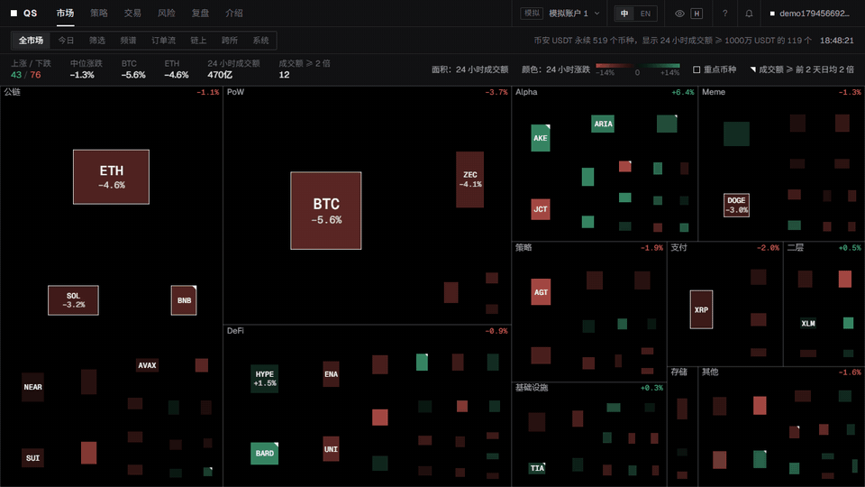

# Temper

[English](README.md) | [简体中文](README.zh-CN.md) | 繁體中文

自行架設的加密貨幣合約交易工作台：即時行情、仿真模擬交易、回測、覆盤，也可以串接自己的幣安帳戶下單。給個人測試自己的策略使用：一台裝好的系統是你一個人的，裝在自己電腦、伺服器還是雲端都一樣。


> 作者只提供這份軟體，不經營任何資金、帶單、跟單、收費或返佣服務，也不推薦任何交易。
> 要不要用、怎麼用、是否符合你所在地區的法律，由你自己判斷並負責。合約交易可能虧掉全部保證金。

## 能做什麼

| | |
| --- | --- |
| 行情 | 幣安 U 本位永續的即時委託簿、成交、K 線；Hyperliquid 鏈上大額持倉與強平地圖；跨交易所資金費率與價差 |
| 模擬交易 | 逐條對齊幣安的規則：手續費、保證金分級、強平與清算費、價格與數量限制、市價單保護、條件單（Algo）、資金費按實際結算；可以模擬不同地區的下單延遲 |
| 回測 | 用模擬交易**同一個撮合引擎**跑幣安歷史 1 分鐘 K 線（最新價與標記價）和歷史資金費率 |
| 串接策略 | TradingView 警報 / Webhook（一句話或 JSON）；程式化的 qsig/1 目標倉位協定（自助建立金鑰、前向記錄、驗證報告）；和幣安一樣的 API（現成的幣安程式改個網址就跑在模擬交易上） |
| 實盤 | 串接自己的幣安 U 本位合約帳戶：金鑰只開交易、不開提領，加密儲存；下單確認預設開啟（可按帳戶關閉，需要二級密碼） |
| 覆盤 | 交易日誌、績效、MAE/MFE、結論、預案、回放練習、高光 |
| 風控 | 紀律鎖（單日虧損、連續虧損、獲利回吐、最大回撤、每筆風險），對模擬交易和實盤都有效；預設關閉，在風險頁開啟 |
| 系統 | 全域停機（停止開新倉 / 再撤掉開倉掛單，所有下單路徑都攔）；寄信信箱、AI 覆盤點評、Telegram、資料來源金鑰在網頁裡填；註冊開關（第一個帳號以後預設關閉）；操作記錄只追加。沒有管理員和角色：這台的帳號權限都一樣 |



## 快速開始

只需要安裝 Docker（Windows、macOS 用 Docker Desktop）和 Git。下載程式碼，在資料夾裡執行一條指令：

```bash
git clone https://github.com/yk-hello/temper.git
cd temper
docker compose up -d
```

不想裝 Git：在 GitHub 頁面上點 Code → Download ZIP，解壓縮後進到資料夾裡執行最後一行。

第一次要在本機建置，需要幾分鐘。然後用瀏覽器開啟 http://localhost:8080 ，註冊一個帳號就能用：

- **不需要任何金鑰和設定檔。** 行情用幣安的公開資料；註冊只要帳戶名和密碼，註冊完直接進去（信箱可以之後在帳戶頁綁定，用來找回密碼、收提醒）；每個帳號自帶一個 10,000 USDT 的模擬帳戶；模擬資金不限額度，可以隨時加減、重設，手續費也能按自己的等級改。
- 第一個註冊的帳號是這台的擁有者：只有它能進右上角齒輪的「系統」頁（全部帳號、全域設定、操作紀錄）。第一個帳號註冊後，別人預設就註冊不進來了（放在雲端也安全）；要多開帳號，在「系統」頁裡新增，或打開註冊。其他帳號只看得到自己的東西。
- 連不上幣安的地方（頁面上方一直顯示「連線中」）：建立一個 `.env` 檔，寫一行 `MARKET_SOURCE=sim`，再執行一次上面的指令，用模擬行情看介面。
- 停止：`docker compose down`（資料保留）。升級：`git pull` 拉取新程式碼，再 `docker compose up -d`（每次都會按新程式碼建置）。

**裝在雲端伺服器上**：網頁預設只在伺服器本機能開（不對外，最安全）。在你自己的電腦上開一條 SSH 通道就能用：

```bash
ssh -L 8080:127.0.0.1:8080 你的使用者名稱@伺服器IP
```

保持這個視窗開著，在自己電腦的瀏覽器開 http://localhost:8080 。想不開通道、直接用網域開（例如在手機上用），先看下方「安全」：要設定 HTTPS 和網域，再改 `QS_BIND`、`ALLOWED_ORIGINS`、`SITE_DOMAIN`。

要改連接埠、用自己的信箱寄信、串接 Telegram、串接幣安實盤，請看下方「設定」。寄信信箱、AI 覆盤點評、Telegram、資料來源金鑰也可以不寫檔案：登入後在「系統」頁（右上角的齒輪）的「系統設定」裡填，儲存後立即生效，每組有「測試」按鈕。常見問題見 [faq.zh-TW.md](docs/faq.zh-TW.md)。

介面目前有簡體中文和英文（在「帳戶 → 語言」切換）。

## 設定（`.env`，不要提交到儲存庫）

全部可選。複製一份 [.env.example](.env.example) 成 `.env`，修改需要的那幾行，再執行一次 `docker compose up -d`。

| 你想做什麼 | 要不要設定 |
| --- | --- |
| 看行情、模擬交易、回測、覆盤、把策略接到模擬交易 | 不用設定 |
| 忘記密碼能找回、郵件通知 | 建議設定寄信信箱（`SMTP_*`） |
| Telegram 通知 | 可選：`TELEGRAM_BOT_TOKEN`（[怎麼建立](docs/telegram.md)，簡體中文） |
| 用自己的幣安帳戶下單 | 不用設定環境變數：在網頁「帳戶」裡填只開了合約交易的金鑰（[說明](docs/live.md)，簡體中文） |
| 讓區域網路裡其他裝置也能開啟 | `QS_BIND=0.0.0.0` 和 `ALLOWED_ORIGINS`（請先看「安全」） |
| AI 覆盤點評 | 可選。建議登入後在「系統」頁新增廠商：可以加好幾家（名稱、API 格式、位址、金鑰、模型、思考程度），用哪家點一下就換，每家都能單獨測試。API 格式兩種：Anthropic（Claude）和相容 OpenAI（DeepSeek、通義千問、Kimi、智譜、OpenAI、Google Gemini 和大多數中轉站）。也可以寫在 `.env`：`AI_API_KEY`、`AI_BASE_URL`、`AI_MODEL`；用 Claude 寫 `AI_FORMAT=anthropic`，只填 `AI_API_KEY` 就行（預設 `claude-opus-5-5`）；思考程度 `AI_EFFORT`（`none`、`low`、`medium`、`high`、`xhigh`，不填按模型自己的設定）。「系統」頁選了廠商時優先用它 |
| 新聞標題 | 不用設定（預設幾家加密媒體的公開 RSS，加上 Bybit、OKX 的官方公告）；想換來源用 `NEWS_FEEDS`，想看 X 上的帳號用 `X_BEARER_TOKEN` + `X_ACCOUNTS` |
| 經濟日曆一直自動更新、看美元指數和美債 | 建議：`FRED_API_KEY`（免費，見下表） |

主要的變數：

| 變數 | 作用 |
| --- | --- |
| `QS_MASTER_KEY` | 加密交易所金鑰和策略金鑰用的主金鑰。不填時第一次啟動會自動產生一把，存在 `qs-data` 資料卷裡（**請備份**：`docker compose cp backend:/data/master.key .`）。自行指定：`openssl rand -base64 32`。遺失後已儲存的金鑰無法解開，只能重新串接 |
| `MARKET_SOURCE` | `binance`（預設，幣安的公開行情，不用金鑰）或 `sim`（模擬行情） |
| `QS_PORT` / `QS_BIND` | 網頁連接埠（預設 8080）和監聽位址（預設 `127.0.0.1`，只有本機能開啟） |
| `ALLOWED_ORIGINS` | 允許從哪些位址開啟（預設只有 localhost）。用區域網路 IP 或網域開啟時加上，例如 `192.168.1.10:*` |
| `QSIG_KEYS` | 程式化策略的金鑰：`key_id:secret:strategy_id`，多組用分號分隔 |
| `BINANCE_API_KEY` / `BINANCE_API_SECRET` | 可選，唯讀即可：讀取所有商品實際的保證金分級（不設定時只有 BTC 是完整的） |
| `QS_LIVE_MAIN` / `QS_LIVE_TESTNET` | 設成 `0` 就不允許串接幣安正式環境 / 幣安模擬交易 |
| `SMTP_HOST` / `SMTP_PORT` / `SMTP_USER` / `SMTP_PASSWORD` | 可選，用你自己的信箱寄信：綁定信箱的驗證碼、忘記密碼、提醒郵件。例如 Gmail 是 `smtp.gmail.com` / `465`，密碼填信箱設定裡產生的「應用程式密碼」，不是登入密碼（QQ、163 信箱叫「授權碼」）。微軟的信箱（Outlook、Hotmail、Microsoft 365）不能用：它只接受 OAuth2 登入。連接埠 465 走 TLS，587 走 STARTTLS；伺服器不支援加密時不寄出 |
| `MAIL_FROM` / `MAIL_FROM_NAME` | 可選：寄件地址（不填用 `SMTP_USER`）和寄件者顯示名稱。設定寄信信箱後，每位使用者的「通知」設定裡多一欄「郵件」（預設只開強平預警、新裝置登入這類和資金、安全有關的，每人每小時最多 20 封） |
| `AUTH_DEV` | 不用填。沒設定寄信信箱時：綁定信箱不用驗證碼，忘了密碼用本機指令重設（網頁上找回不了，免得別人拿你的信箱改密碼）；設定寄信信箱後走郵件驗證碼。`1` 只給開發者測試用：驗證碼顯示在頁面上，不要在別人能開啟的機器上用 |
| `QS_WEBHOOK_PRIVATE` | 預設 `0`：對外 Webhook 不送到本機和內網位址。只在自己的內網部署、要送到內網服務時設為 `1` |
| `NEWS_FEEDS` | 市場頁「今日」裡的新聞標題從哪裡取得：不填用預設的公開 RSS（CoinDesk、Cointelegraph、Decrypt），自行填寫多個網址用逗號分隔，`off` 不取得。只儲存、只顯示標題、來源、時間和原文連結，不轉載內文；平台不拿新聞做買賣判斷 |
| `X_BEARER_TOKEN` / `X_ACCOUNTS` | 可選：用你自己的 X 開發者 token（X 官方 API，按用量收費）看幾個帳號的貼文，每 15 分鐘取一次。不爬網頁 |
| `FRED_API_KEY` | 建議：聖路易斯聯儲的免費金鑰（[fred.stlouisfed.org](https://fred.stlouisfed.org) 註冊，在 My Account → API Keys 建立）。填了以後 CPI、非農、PPI、議息這些日程全自動更新，市場頁「今日」多顯示美元指數、美債 10 年、標普 500。不填時：經濟分析局（PCE、GDP）的日程照樣線上更新；勞工統計局（CPI、非農、PPI）拒絕程式存取，使用程式內建的日程（目前到 2027 年底），快用完時頁面上提前兩個月提醒，升級到新版本也會帶上新的 |
| `QS_LIMIT_*` | 可選：每人的上限，不填就是預設值。`QS_LIMIT_PAPER_ACCOUNTS`（模擬帳戶，10）、`QS_LIMIT_BACKTEST_DAYS` / `_INSTRUMENTS` / `_SIGNALS`（回測一次最多幾天、幾個品種、幾條訊號：180、5、20000）、`QS_LIMIT_STRATEGIES`（策略，20）、`QS_LIMIT_API_KEYS`（和幣安一樣的介面金鑰，10）、`QS_LIMIT_PRICE_ALERTS`（到價提醒，50）、`QS_LIMIT_RULES`（條件提醒，20）、`QS_LIMIT_SHOT_MB` / `QS_LIMIT_SHOTS_TOTAL_MB`（復盤截圖單張、總共，5、500）、`QS_LIMIT_SIGNUP_PER_IP_HOUR`（同一網路一小時最多註冊幾個，10）。介面上的提示跟著改。模擬資金本身不限額度 |
| `NEWS_NOTICES` / `LIQ_FEEDS` | 預設都開：`off` 分別關掉 Bybit、OKX 的官方公告（上新、下架、維護），以及它們的全量強平推送（幣安的強平推送每個幣每秒只有一筆，看不全） |
| `QS_SIGNUP` | 可選：`open` = 第一個帳號以後別人也能自己註冊。預設 `closed`：註冊進來的人和你一樣能改「系統」頁的所有設定，所以只在自己電腦上、或只給信得過的人時再打開（「系統」頁裡也能改） |

## 文件

詳細說明目前只有簡體中文：

- [策略作者指南](docs/strategy-guide.md)：適合串接什麼樣的策略、怎麼驗證、常見的坑、空白範本（我們不提供策略）
- [串接策略](docs/strategies.md)：TradingView / Webhook、qsig/1、從回測到模擬交易再到實盤
- [策略用的資料從哪裡來](market-data.md)：K 線、資金費、持倉量、新聞、總經數據去哪裡取，歷史能取多久，什麼時候才拿得到
- [讓策略一直跑](running.md)：用 Docker、systemd 或 Windows 循環腳本，當掉、重開機了自己起來；為什麼重啟不會多下單
- [回測](docs/backtest.md)：訊號表寫法、命令列、和真實交易不一樣的地方
- [串接幣安實盤](docs/live.md)：怎麼建立金鑰、安全設計、哪些功能只在模擬交易
- [和幣安一樣的 API](docs/binance-api.md)：現成的幣安程式改個網址、換一把模擬金鑰就跑在模擬交易上
- [Telegram 通知](docs/telegram.md)：部署的人自行建立 bot（可選），每位使用者綁定自己的
- [qsig/1 協定](docs/qsig-1.md)：程式化策略送出目標倉位的格式、簽章、回報
- 範例程式：[examples/](docs/examples/)（只用 Python 標準函式庫）

## 安全

- 交易所金鑰只需要「允許合約」；開了提領或劃轉的金鑰會被拒絕儲存。程式碼裡沒有任何提領、劃轉的呼叫。
- 預設只監聽本機（`127.0.0.1:8080`）。放到公網前要設定 HTTPS、寄信信箱（`SMTP_*`，不然忘了密碼只能在伺服器上用指令重設）、`SITE_DOMAIN`，並修改資料庫密碼。
- 不要用 `http://` 直接從公網打開：同一網路裡的人能看到登入密碼、驗證碼和登入憑證。用 SSH 通道或 HTTPS；用不加密的網址打開時，登入頁會提示「連線沒加密」。
- 用自己的信箱寄信時，收件人會看到你的寄件地址；Gmail 這類個人信箱一天大約能寄幾百封，人多了請改用專門的寄信服務。
- 發現安全問題請私下聯絡維護者，不要公開開 issue。

## 授權

[Apache License 2.0](LICENSE)：可以自由使用、修改、再散布，包括商業用途；需保留版權聲明和 [NOTICE](NOTICE)，修改過的檔案要註明。軟體依「現狀」提供，不做任何擔保，不授予商標使用權。

用到的第三方元件和它們的授權見 [THIRD_PARTY.md](THIRD_PARTY.md)（都是 MIT、Apache-2.0、ISC、BSD 和字型的 OFL 這類寬鬆授權）。

本專案不提供交易策略、訊號或投資建議。帳戶、金鑰和資金都是你自己的，盈虧自負。
